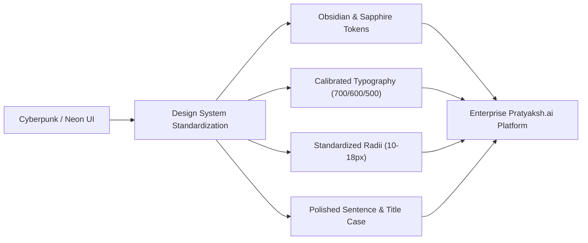

# Enterprise UI/UX Modernization & Design System Upgrade

## 1. Executive Summary

The mobile application interface has been elevated from a cyberpunk / sci-fi styling (radioactive neon cyan glows, 28–30px bubbly cards, `900` black-weight typography, all-caps shouting CTAs, and broken light theme contrast) into an **enterprise-grade biometric and academic management platform** inspired by modern design systems like Apple iOS Human Interface Guidelines, Linear, Stripe, and Tailwind UI.

---

## 2. Design System Foundations

### 2.1 Calibrated Dual-Engine Palette

Both Dark Mode and Light Mode were re-engineered with high-contrast, accessibility-tested color tokens:

| Token | Dark Mode (Obsidian Slate) | Light Mode (Pure / Cool Slate) | Purpose |
| :--- | :--- | :--- | :--- |
| `bg` | `#0B0F19` (Deep Obsidian) | `#F8FAFC` (Slate 50) | Core canvas background |
| `bgElevated` | `#111827` (Slate 900) | `#FFFFFF` (Pure White) | Layered cards & sheet backdrops |
| `card` | `#151E32` (Navy Slate) | `#FFFFFF` (Elevated White) | Primary interactive card bodies |
| `cardSubtle` | `rgba(21, 30, 50, 0.7)` | `#F1F5F9` (Slate 100) | Secondary surfaces & inactive tabs |
| `cyan` *(Primary Accent)* | `#3B82F6` (Sapphire Blue 500) | `#2563EB` (Royal Blue 600) | Primary actions, branding, active states |
| `cyanGlow` | `rgba(59, 130, 246, 0.12)` | `rgba(37, 99, 235, 0.08)` | Subtle focus rings & badges |
| `border` | `rgba(255, 255, 255, 0.08)` | `#E2E8F0` (Slate 200) | Crisp, structural dividing borders |
| `borderAccent` | `rgba(59, 130, 246, 0.28)` | `rgba(37, 99, 235, 0.22)` | Active borders & highlight strokes |
| `text` | `#F9FAFB` (Slate 50) | `#0F172A` (Slate 900) | High-contrast, readable headers & text |
| `muted` | `#94A3B8` (Slate 400) | `#64748B` (Slate 500) | Secondary text & descriptive captions |
| `emerald` | `#10B981` (Emerald 500) | `#059669` (Emerald 600) | Verified statuses, present marks |
| `rose` | `#F43F5E` (Rose 500) | `#E11D48` (Rose 600) | Absent marks, destructive actions |

> [!TIP]
> Mapping the existing `cyan` key directly to sapphire/royal blue tokens (`#3B82F6` / `#2563EB`) instantly transformed all primary buttons, chips, and indicators across 500+ component call sites while preserving 100% backwards compatibility.

---

### 2.2 Typography Hierarchy

- **Elimination of `900` / `800` Weights**: Replaced with clean weights (`700` Bold for section titles/KPI values, `600` Semi-Bold for buttons/labels, `500` Medium for inputs/body text).
- **Sentence & Title Case Copy**: Replaced uppercase shouting labels (e.g. `ROLL NUMBER`, `ATTENDANCE SCOPE`, `PROCESS 2 PHOTOS`, `EDIT STUDENT DETAILS`, `EXPORT SESSION PDF`) with clean executive formatting (`Roll Number`, `Attendance Scope`, `Process 2 Photos`, `Edit Student Details`, `Export Session PDF`).
- **Normalized Letter Spacing**: Tightened wide cyberpunk tracking (`letterSpacing: 2` and `0.8`) to natural system metrics (`-0.3` for headers, `0.2` for interactive badges).

---

### 2.3 Component Geometry & Shadows

- **Border Radii**:
  - Modals & Sheets: Normalized from `24–28px` to **`16–18px`**.
  - Metric & Dashboard Cards: Normalized from `22–26px` to **`14px`**.
  - Inputs & Action Buttons: Standardized to **`10px`** with an ergonomic **`44–46px`** touch height.
  - Badges & Chips: Standardized to **`6–8px`**.
- **Shadow System**: Replaced glowing cyan drop shadows (`shadowColor: "#00F5FF"`, `shadowOpacity: 0.4`, `shadowRadius: 16`) with soft, natural neutral elevation (`shadowColor: "#000"`, `shadowOpacity: 0.08 - 0.15`, `shadowRadius: 4 - 8`).

---

## 3. Screen-by-Screen Transformation

### 3.1 Splash & Authentication
- **Branding**: Elevated branding to **`Pratyaksh.ai`** with the subline *"Intelligent Biometric & Attendance Platform"*.
- **Telemetry Pill**: Modernized the status pill to *"Verified Campus Network"*.
- **Hero & Login Card**: Removed ambient neon blobs and glowing outer rings. Implemented a clean, elevated container with subtle borders.
- **Segmented Role Selector**: Upgraded role selector tabs to compact segmented buttons with smooth active pill states.
- **Form Controls**: Added clear placeholders, standardized input heights (46px), and refined CTAs (*"Sign In as Administrator"*, *"Sign In as Faculty"*, *"Sign In as Student"*).

### 3.2 AppShell & Bottom Navigation Dock
- **Navigation Dock**: Replaced the floating bubbly dock with an iOS-style dock (`borderRadius: 18`, subtle `rgba(0,0,0,0.08)` elevation).
- **Active Tab Pill**: Subtle active indicator with refined icon sizing and balanced typography.
- **Header Island**: Sleek top bar with clean role chips, profile avatar pills, and high-contrast status dots.

### 3.3 Dashboard Experiences (Admin, Teacher, Student)
- **KPI Metrics Matrix**: Clean 2-column KPI grid with 14px radius, clear labels, and 700-weight digits.
- **Quick Action Grid**: Refined icon badging with soft tint backgrounds instead of heavy neon borders.
- **Session Timetable Cards**: Clean row layout with a left-aligned time badge, title, and metadata.
- **Upload Donut Indicator**: Replaced toy-like 24-segmented clock ticks and hardcoded dark container with an executive smooth SVG-based circular progress ring that adapts to dark and light modes.

### 3.4 Camera Viewfinder & Biometric Attendance HUD
- **Camera Viewport**: Clean 14–16px rounded viewfinder with subtle corner guide lines.
- **Capture Controls**: Replaced oversized 74px neon shutter ring with an ergonomic 48px shutter button with clear labeling.
- **Photo Verification & Roster Modals**: Clean image previews, compact status pills (Present/Absent), and neatly formatted student information.

---

## 4. Technical Verification

- **TypeScript Compilation**: Executed `npm --prefix mobile-expo run typecheck` (`tsc --noEmit`) with **0 errors**.
- **Logic & API Integrity**: Zero alterations to network calls, authentication mechanisms, camera hooks, or biometric verification payload structures.
